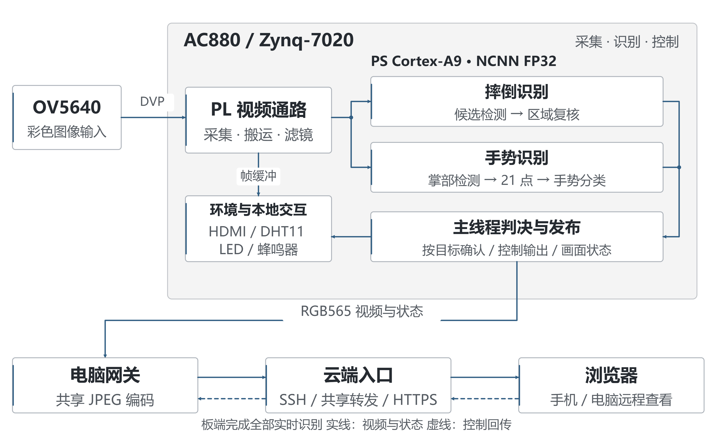
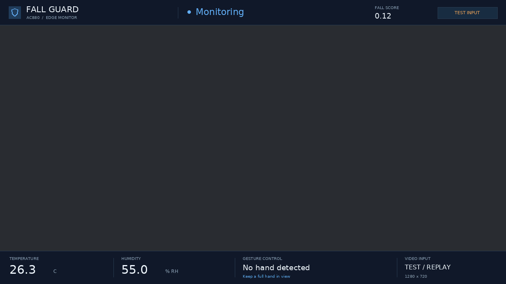

# 跌倒识别与环境智控系统

基于 AC880（Zynq-7020）与 OV5640 的室内安全监护系统，集成跌倒识别报警、手势控制、温湿度监测、本地显示和远程网页访问。系统利用 Zynq 的 PS 与 PL 协同完成视频采集、图像处理、板端推理和外设控制，全部实时识别均在开发板上运行，无需采集无人背景。

[项目源码](./) · [技术报告](./docs/technical_report.md) · [部署说明](./docs/reproduce.md) · [代码导读](./docs/code_guide.md)

## 功能概览

| 功能 | 实现内容 |
| --- | --- |
| 跌倒识别与报警 | 检测倒地候选区域，进行区域复核与逐目标时序确认，通过画面提示、LED 和蜂鸣器报警，并记录事件 |
| 手势控制 | 张掌点亮 8 颗用户 LED，握拳关闭 LED，V 手势使蜂鸣器短鸣 0.5 秒 |
| 视频显示 | OV5640 采集 720p 图像，HDMI 显示实时画面、识别框和设备状态 |
| 图像处理 | 网页选择原图、灰度、Sobel 边缘模式，并调节亮度和对比度 |
| 环境监测 | 读取 DHT11 温湿度，检查读数有效性并在界面显示 |
| 网页交互 | 查看视频、识别及环境状态，手动控制外设，查询报警记录并提交反馈 |
| 远程访问 | 通过 HTTPS 域名访问，视频与控制接口统一登录验证，控制操作校验令牌 |

## 系统设计



| 组成 | 承担任务 |
| --- | --- |
| PL：FPGA 可编程逻辑 | 摄像头接入、视频 DMA、帧数据搬运、图像处理，以及环境和输出外设接口 |
| PS：ARM 处理系统 | PYNQ/Linux、NCNN 推理、跌倒时序判决、手势确认、HDMI 叠加及板端网页服务 |
| 电脑网关 | 接收板端视频、共享 JPEG 编码、提供局域网访问，并维护云端 SSH 隧道 |
| 云服务器 | HTTPS、登录验证、视频共享分发和远程控制转发 |

神经网络采用配套 ARM NCNN 运行库在 PS 上执行；PL 承担视频与外设处理。电脑和云服务器不参与实时识别。

**跌倒处理流程：** 原始彩色图像 → 候选区域检测 → 区域复核 → 按目标累积有效证据 → 报警及事件记录。

**手势处理流程：** 掌部检测 → 21 点关键点恢复 → 手势分类 → 稳定确认 → LED／蜂鸣器控制。稳定确认要求持续至少 0.5 秒且获得至少两个新识别样本，同一姿势持续保持只触发一次。0.5 秒是确认窗口，完整响应时间还包含采集、推理与调度耗时。

SW0 选择当前识别任务，每路最多保留一个在途任务，切换时先排空并丢弃旧结果，避免跨模式误触发；显示、网页更新和识别分别调度。滤镜只作用于显示链路，模型使用原始彩色图像。

## 硬件与软件

| 项目 | 配置 |
| --- | --- |
| 开发板 | 单块 AC880，Zynq-7020，器件 `xc7z020clg484-2` |
| 摄像头 | OV5640 |
| 显示与输出 | HDMI、8 颗用户 LED、蜂鸣器 |
| 环境传感器 | DHT11 |
| 板端环境 | PYNQ/Linux、Python、NumPy、OpenCV、Pillow、配套 ARMv7 NCNN 动态库 |
| 硬件开发 | Vivado 2025.2，Verilog、Block Design、XDC |
| 网关与云端 | Python、OpenSSH、Nginx、HTTPS |

摄像头及 HDMI 使用 1280×720；显示刷新上限为 12 FPS。网页视频采用 640×360、JPEG 质量 75、发送上限 15 FPS。上述上限是显示或传输配置，不代表模型识别频率。

## HDMI 显示

顶部显示监护状态、跌倒评分和输入模式，底部显示温湿度、手势提示及视频信息。报警使用红色状态和画面边框；过期环境数据隐藏数值，手机回放明确标记。界面面板在信息变化时才重新绘制，直接叠加到 RGB565 显示缓冲区。



图中为布局预览与示意数据，不作为识别或传感器实测结果。

## 网页显示

网页在浏览器中独立绘制状态、评分、温湿度和手势文字，全屏显示不随视频压缩。视频使用最新帧解码，局域网与远程访问共享一次视频接收和编码。显示上限保持 12 FPS，网页发送上限保持 15 FPS。停止共享网页网关时，局域网和远程网页同时断开，板端识别继续运行。

## 源码导航

源码按板端软件、硬件、模型和远程服务组织：

| 入口 | 内容 |
| --- | --- |
| [板端软件](./board_runtime/app/) | 硬件接入、识别、调度、判决、显示与网页；只保留一份源码 |
| [运行配置](./board_runtime/config.json) | 板端参数配置 |
| [板端运行包](./board_runtime/) | 配对模型、bit/hwh、NCNN、程序和校验清单 |
| [硬件工程](./hardware/current/) | 顶层 RTL、视频与外设逻辑、Block Design、约束及重建脚本 |
| [模型训练与导出](./ac880_fall/ml/) | 数据处理、训练、区域复核及模型导出 |
| [启动和部署脚本](./ac880_fall/scripts/) | 运行包构建、电脑网关、云端部署及验证工具 |
| [云端服务](./ac880_fall/cloud/) | Nginx 配置、服务模板和共享视频转发 |
| [技术文档与结构图](./docs/) | 技术报告、使用说明、结构图和界面布局 |

板端源码集中在 `board_runtime/app/`，部署时复制整个 `board_runtime/` 即可。训练程序、电脑网关及云端配置单独存放，测试位于 `ac880_fall/tests/`。

## 使用说明

### 1. 连接设备

断电状态下接好 OV5640、HDMI、DHT11 和网线，再给开发板上电。现有连接方式为开发板网线直连电脑，板端地址为 `192.168.2.99`。

DHT11 接线：VCC 接 P7-29（3.3V），GND 接 P7-30，DATA/S 接 P7-31。接线前核对模块丝印。

### 2. 启动板端识别

在电脑终端通过 SSH 登录开发板：

```powershell
ssh xilinx@192.168.2.99
```

在已部署的运行目录执行：

```bash
cd /home/xilinx/fall_gesture_trial
./run.sh
```

程序自动加载模型与配对 bit/hwh，初始化摄像头、HDMI 和外设，按 SW0 选择识别任务。保持运行终端打开。

使用板上的**用户拨码开关 SW0（第 0 位）**切换：

| SW0 位置 | 识别任务 | 暂停的任务 |
| --- | --- | --- |
| 向下（0） | 摔倒识别与报警 | 手势识别和手势控制 |
| 向上（1） | 手势识别与控制 | 摔倒识别和摔倒报警 |

切换时消抖 150 毫秒，排空在途任务并丢弃旧结果，重新积累确认样本；旧报警或手势短鸣结束。HDMI 与网页显示当前模式。环境采集、实时画面和网页手动控制持续可用。使用用户 SW0，不改动启动方式选择开关；手势模式期间不监测摔倒。


另开一个 SSH 窗口查看状态：

```bash
cd /home/xilinx/fall_gesture_trial
./run.sh status
```

`running` 和 `camera_ready` 均为 `true`，且 HDMI 出现实时画面，表示已就绪。

### 3. 打开网页

在源码根目录选择需要的访问方式执行。电脑网关不会代替启动板端识别程序。

**局域网访问：**

```powershell
powershell -NoProfile -ExecutionPolicy Bypass -File .\ac880_fall\scripts\start_home_lan.ps1
```

本机访问 `http://127.0.0.1:8088`；手机与电脑连接同一 Wi-Fi，访问脚本显示的电脑地址。

**远程访问：**

```powershell
powershell -NoProfile -ExecutionPolicy Bypass -File .\ac880_fall\scripts\start_home_cloud.ps1
```

打开 [shuaidao.online](https://shuaidao.online)，使用已配置的网页登录凭据。远程使用期间保持开发板、电脑、SSH 隧道及云服务器运行，电脑联网且不休眠。现有远程链路使用两台云实例进行隧道中继，连接关系见 [云端部署说明](./ac880_fall/cloud/README_CN.md)。

换电脑部署时，先按实际环境调整脚本中的 Python、日志、密钥和主机路径。私钥与登录凭据单独配置，不放入源码仓库。

### 4. 停止与关机

在另一个 SSH 窗口执行：

```bash
cd /home/xilinx/fall_gesture_trial
./run.sh stop
sudo shutdown -h now
```

等待系统关机后再断电。程序持有摄像头和 DMA 时应通过停止命令释放资源。

### 5. 从源码部署

仓库中的 `board_runtime/` 已包含配套模型、ARM NCNN 动态库、bit 和 hwh。先执行 `python tools/verify_runtime.py` 校验文件，再将完整目录复制到开发板的 `/home/xilinx/fall_gesture_trial`，执行 `chmod +x run.sh run_home.sh run_fall.sh`。首次安装仍需已验证的 PYNQ/Linux 系统与 Python 依赖；运行包不替代系统镜像。完整运行文件组成、构建参数及校验步骤见 [复现与部署说明](./docs/reproduce.md)。

硬件工程重建入口为 [build.tcl](./hardware/current/Scripts/build.tcl)。该脚本重建工程并验证 Block Design；追加 `bitstream` 参数可执行综合、实现和配置文件生成，详见硬件目录说明。

## 验证说明

在已有依赖环境中，于仓库根目录执行软件回归：

```powershell
$env:PYTHONPATH = 'ac880_fall/ml;board_runtime/app'
python -c "import cache_env,unittest,sys; r=unittest.TextTestRunner().run(unittest.defaultTestLoader.discover('ac880_fall/tests',pattern='test*.py')); sys.exit(not r.wasSuccessful())"
```

当前方案 96 项软件回归通过，SW0 寄存器及同步逻辑已通过 XSim 自检，配套配置文件已完成综合和实现；拨码新增功能的实物验收待接板完成。视频、外设和 HTTPS 访问链路已完成集成检查。软件回归检查程序逻辑，不等同于识别准确率或真实人员现场验收；手机屏幕回放单独作为集成测试记录。

识别仍存在偶发手部误报、部分跌倒漏报和手势响应偏慢的情况；DHT11 湿度校准、硬件方法学及 CDC 问题仍需完善。测试条件与结果见 [技术报告](./docs/technical_report.md) 的完成情况及性能参数部分。

视频流解析、慢解码丢帧与重连隔离检查：`node ac880_fall/tests/test_video_stream.cjs`。

## 数据与许可

训练数据、用户原始画面、访问凭据和工具缓存不包含在源码提交中。模型、日志和构建输出统一保存在 E 盘，缓存使用 `E:/Zynq_cache`，临时文件使用 `E:/Zynq_cache/temp`。

第三方代码、模型和数据遵循各自许可与使用条件，汇总见 [许可与来源](THIRD_PARTY_NOTICES.md)；来源和许可见 [运行时声明](./board_runtime/assets/licenses/) 与 [数据来源说明](./board_runtime/assets/DATA_SOURCES.md)。
