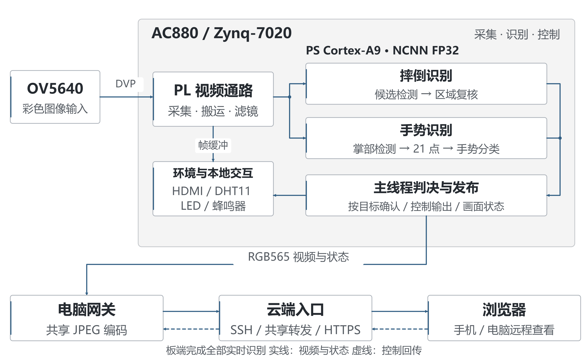
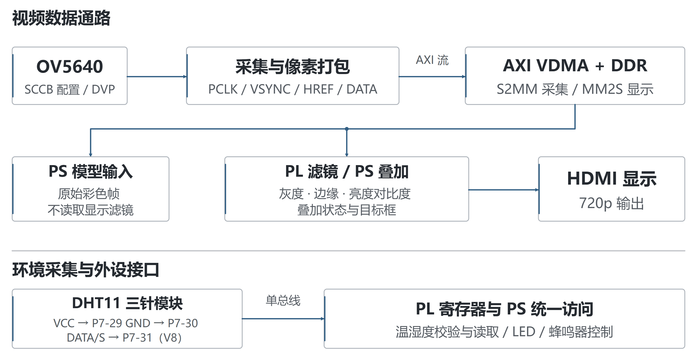
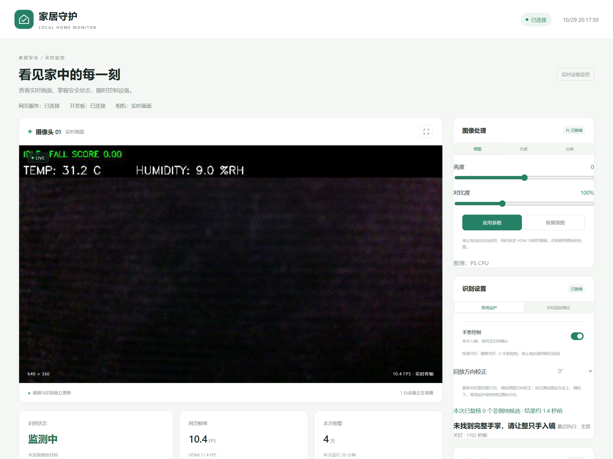
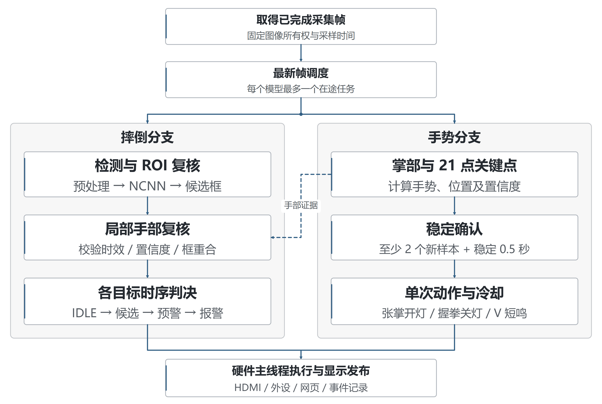

# 跌倒识别与环境智控系统

## 摘要

本作品面向室内安全监护场景，采用单块 AC880 开发板与 OV5640 摄像头，构建集跌倒识别、环境数据显示、手势控制和远程视频访问于一体的原型系统。系统利用 Zynq-7020 的处理系统与可编程逻辑分工：PL 完成摄像头采集、视频搬运、图像处理与外设接口，PS 在开发板本地执行摔倒检测及手部关键点推理，并根据连续有效证据控制报警。识别不要求预先采集无人背景，电脑和云服务器不承担实时识别。

在摔倒检测方面，系统在原有检测骨干基础上增加候选区域复核，并为不同目标分别维护报警状态。对新鲜、高置信度的手部结果，仅复核与其高度重合的倒地候选，避免一个手部目标屏蔽其他人体。手势控制支持张掌开灯、握拳关灯和 V 手势短鸣，并通过稳定窗口、重复样本过滤和单次触发限制避免持续重复控制。显示链路与识别任务独立更新，远程视频使用共享编码和共享转发，减少多观看端造成的重复计算。

系统已实现 720p 摄像头与 HDMI 输出、PL 灰度及边缘处理、亮度和对比度调节、DHT11 数据显示，以及受登录保护的 HTTPS 网页。当前低延迟网页采用 640×360 视频；一次 60 秒公网接收测试约为 9.76 FPS。软件回归 102 项通过。现阶段仍有局部手部误报、手势响应偏慢和部分跌倒漏报，相关结果与视频性能分别记录，后续重点是补充独立场景验收和提高板端推理效率。

## 第一部分 作品概述

### 1.1 功能与特性

系统通过 OV5640 采集室内画面，在 AC880 上完成倒地候选识别、区域复核和时序报警，并将状态叠加到 HDMI 与网页。DHT11 温湿度读数同步显示；张掌点亮 8 颗用户 LED，握拳关灯，V 手势使蜂鸣器短鸣 0.5 秒。网页可手动控制外设、查询报警记录、提交反馈，以及调节 PL 图像处理参数。公网访问使用域名与 HTTPS，视频和控制接口统一验证登录。设备采用手动启动。

### 1.2 应用领域

作品主要用于居家看护、室内值守和嵌入式视觉教学验证。使用者可在本地显示器查看状态，也可通过手机或电脑远程查看画面和设备读数；手势提供一种不接触按键的简单交互方式。部署时需固定摄像头朝向并覆盖人员活动区域。当前版本属于功能验证原型，适用于展示端侧识别、视频链路和外设控制闭环；复杂遮挡、局部取景和不同人员条件下的识别可靠性仍需扩大测试。

### 1.3 主要技术特点

采用 PS 与 PL 分工实现视频、推理和控制协同：PL 承担连续视频数据通路及外设时序，PS 使用 ARM NCNN 执行 FP32 推理。摔倒复核复用检测骨干特征，减少额外网络计算；不同目标分别确认报警，重复及过期结果不推进状态。手势与摔倒分别处理最新帧，每个模型最多一个在途任务。显示滤镜只作用于输出，模型始终读取原始彩色图像。远程网关共享 JPEG 编码，云端按观看需求拉取一路视频，再向多个客户端分发。

### 1.4 主要性能指标

| 项目 | 当前结果 |
| --- | --- |
| 摄像头与 HDMI | 1280×720 |
| 远程视频 | 640×360，60 秒约 9.76 FPS |
| 公网视频负载 | 约 1.13 Mbps，单路样本 |
| 手势确认 | 稳定 0.5 秒且至少两个新样本 |
| 软件回归 | 102 项通过 |
| PL 资源 | LUT 23.78%，BRAM 20% |

### 1.5 主要创新点

（1）将跌倒、手势和环境显示整合到单板，形成视频、判决与外设控制闭环。

（2）共享检测特征进行区域复核，并限制手部复核的空间和时间范围，保留独立人体报警能力。

（3）将显示、模型任务与远程分发解耦，通过最新帧调度和共享视频减少积压。

### 1.6 设计流程

先打通 OV5640、VDMA 与 HDMI 视频链路，再接入板端检测和时序报警；随后增加 DHT11、手势及网页控制，完成 HTTPS 远程部署；最后针对误报、帧积压和多观看端负载迭代，通过软件回归、数值核对及实机记录检查效果。

## 第二部分 系统组成及功能说明

### 2.1 整体介绍

系统由板端采集与处理、电脑视频网关、云端访问入口和浏览器四部分组成。AC880 是唯一的实时识别设备。OV5640 的 DVP 数据经 PL 采集后写入 DDR，PS 从已完成的帧缓冲区取得原始画面，分别提交摔倒和手势任务。判决完成后由硬件主线程统一执行外设控制和显示更新，HTTP 线程不直接操作寄存器。

板端网页向电脑网关提供 RGB565 视频与状态，电脑完成共享 JPEG 编码后通过 SSH 隧道转发。云端 Nginx 负责 HTTPS 和登录验证，视频转发器将一路上游 MJPEG 分发给多个观看端。当前部署使用香港服务器，并经一台中继服务器维持 SSH 链路。电脑、开发板及隧道须持续运行，云端服务不能脱离板端独立完成识别。

### 2.2 硬件系统介绍

#### 2.2.1 硬件整体介绍

核心平台为 AC880，器件型号为 xc7z020clg484-2。Zynq-7020 在同一器件内包含 ARM Cortex-A9 处理系统和 FPGA 可编程逻辑，二者通过 AXI 接口及共享 DDR 交换数据[1]。全部实时识别在该板 PS 侧执行。

PL 侧包括 OV5640 初始化、DVP 采集、像素转换、AXI 视频搬运、显示输出和外设接口；PS 侧运行 PYNQ/Linux 与应用程序，加载配对的 bit/hwh 文件，管理缓冲区和推理任务。当前保留的 PL 工作主要是视频与接口处理，已移除未作为最终方案的旧卷积加速端点。

| 部件 | 作用 | 连接与数据 |
| --- | --- | --- |
| AC880 | 采集、推理、显示及控制 | ARM PS 与 FPGA PL 协同 |
| OV5640 | 彩色视频采集 | DVP 像素与同步信号，SCCB 配置 |
| HDMI 显示器 | 本地画面和状态显示 | 720p 视频输出 |
| DHT11 模块 | 温湿度采集 | 3.3V、GND、单总线 DATA |
| 用户 LED 与蜂鸣器 | 手动、手势和报警输出 | 由板端统一控制 |
| 电脑与网络 | 编码、网页网关及隧道 | 不承担实时识别 |

#### 2.2.2 机械设计介绍

原型采用开发板、摄像头和传感器模块组合搭建，未设计专用外壳或机械运动结构。安装时固定摄像头，避免线缆拉扯和镜头遮挡；DHT11 与发热器件保持距离。电源、网络及 HDMI 线缆从板侧引出，预留摄像头和传感器连接空间。整机和接线照片位置见第三部分。

#### 2.2.3 电路各模块介绍

摄像头初始化模块经 SCCB 配置 OV5640。DVP_Capture 根据 PCLK、VSYNC、HREF 与像素数据形成视频流，经 FIFO 和像素打包后送入 VDMA。AXI4-Stream 使用有效、就绪及行帧边界信号传递图像，VDMA 在流接口与 DDR 帧缓冲区之间搬运数据[2]。采集与显示使用独立缓冲区，减少 CPU 标注与相机写入相互覆盖。

图像处理链路保留原图、灰度和 Sobel 边缘模式，支持亮度及对比度调节。软件先准备 DMA 接收端，再启动发送端，并在完成后发布显示帧。滤镜不改写模型使用的原始彩色快照。显示文字和识别框在处理后的图像上叠加，以保持状态信息可读。

DHT11 使用三针模块，VCC 接 P7-29 的 3.3V，GND 接 P7-30，DATA/S 接 P7-31，对应 FPGA V8。按模块丝印核对针序后连接，避免按线缆颜色判断。PL 约每 5 秒完成一次采样及校验，软件读取有效状态和缓存值；数据过期后隐藏旧读数。环境值仅作原型展示，当前湿度与参考读数存在偏差，尚未完成校准。

### 2.3 软件系统介绍

#### 2.3.1 软件整体介绍

板端软件按硬件接入、推理、判决、显示和服务划分。manage.py 负责手动启动及进程状态；realtime.py 持有硬件资源并驱动主循环；SharedFallDetector 与 HandModels 分别封装检测和手势模型；TrackedFallDetector 与 GestureController 处理时序；home_web.py 提供状态、视频及控制接口。

图 3 为实际运行页面截屏，显示连接状态、视频、图像处理参数和手势提示，画面中的读数及报警累计属于截屏时状态。界面帧率不能替代识别速度或准确率。网页还提供环境读数、LED/蜂鸣器控制、报警历史与反馈；修改请求先完整校验，再由硬件主线程统一应用。

电脑网关只保留一份上游原始视频和共享 JPEG 结果。香港视频服务只监听回环地址，并由 Nginx 统一对外发布；无观看者时停止持续拉流，慢客户端跳过旧帧。HTTPS 提供传输保护，登录验证覆盖页面、状态、视频及控制路由，控制请求另校验令牌，防止仅凭跨站请求改变设备状态。

#### 2.3.2 软件各模块介绍

主循环先确认摄像头已出帧，再管理视频缓冲区和模型任务。模型忙碌时不继续排队；结果返回后检查样本序号、源时间和控制代次。显示任务可独立更新，即使模型尚未完成，也能继续显示新画面。退出时先停止视频和 DMA，确认不再访存后释放物理缓冲区。

摔倒网络输入为 320×192，图像先按比例缩放与补边，再归一化并通过 NCNN 推理[3]。解码阶段恢复原图坐标并进行候选筛选。区域复核器复用骨干多层特征，不再运行第二个完整人体骨干；当前 refined_v5 复核器还需通过 v4 参考复核。未识别到人体或某一物体时，不直接推断画面安全。

局部手部复核要求手部与摔倒结果时间接近，掌部置信度不低于 0.8、关键点置信度不低于 0.95，并且具有完整 21 点结果。仅将与手框 IoU 不低于 0.65 的倒地候选记为手部区域；其他目标保留。手掌被裁切时可能无法满足这些条件，因此该规则不能保证消除所有近距离误报。

时序判决为 IDLE、CANDIDATE、ALARM_ARMED、ALARM 四级。当前候选确认参数为 0.4 秒，预警保持参数为 0.8 秒；实际响应还受模型周期和新鲜证据到达时间影响。各目标分别维护状态，重复、过期或不相干目标的结果不用于累积同一报警。报警事件写入结构化记录，可关联截图供事后复核；反馈不直接自动训练或修改在线阈值。

手势分支采用掌部检测与 21 点关键点模型[4-5]。根据指节夹角、指尖相对距离和两指间距区分张掌、握拳及 V。V 主要检查食指和中指伸展分开、无名指和小指折叠，避免拇指被遮挡时直接否决。每个控制动作要求稳定 0.5 秒且至少两个新样本；同一姿势持续保持仅触发一次，V 短鸣保留冷却间隔。手机回放测试模式暂停手势控制，并允许手动校正画面方向；现场监护保持原始方向。

| 核心模块 | 关键输入 | 关键输出与约束 |
| --- | --- | --- |
| VDMAManager | 摄像头帧索引、帧地址 | 自有原始帧与可发布显示帧 |
| ConcurrentGestureInference | 新帧与采样时间 | 摔倒和手势结果独立完成 |
| SharedFallDetector | RGB 图像、模型文件 | 候选框、得分、复核标签 |
| review_hand_region | 候选框、手部框与时间 | 保留目标及局部复核记录 |
| TrackedFallDetector | 新鲜检测结果 | 各目标状态与报警事件 |
| GestureController | 手势、序号与时间 | 单次 LED 或有限时长蜂鸣命令 |
| HomeOutputs | 网页或手势命令 | 经校验的控制状态，主线程执行 |
| SharedVideo 与转发器 | 自有帧或 MJPEG | 共享最新帧，限制缓存积压 |

训练工具位于 ml，板端运行代码位于 sw，部署脚本与云端配置分别位于 scripts 和 cloud。训练以实际 FallDataset 资源为基础，补充公共数据及相机负例。CAUCAFall 用于补充姿态和取景变化[6]，URFall 回放用于开发回归[7]。相机手部样本、开发回归及真实人员现场验收分别记录；参与调参或训练的样本不作为独立验收结果。

## 第三部分 完成情况及性能参数

### 3.1 整体介绍

系统已完成从摄像头采集到本地显示、板端识别、外设响应和公网访问的链路集成。程序部署于独立运行目录；启动脚本提供 run、status、stop，未启用开机自动识别。运行不依赖先拍摄空背景。

<photo:front|整机正面照片|请替换为整机正面实拍，包含开发板、摄像头、显示器及外设，不出现学校或个人身份信息。>

<photo:angle|整机斜 45 度全景照片|请替换为整机斜 45 度实拍，展示各模块位置、供电与主要连线。>

### 3.2 工程成果

#### 3.2.1 机械成果

已完成模块式原型搭建和摄像头固定。当前无专用外壳、定制支架或机械执行机构，后续可在保持取景和散热的前提下集成结构件。

#### 3.2.2 电路成果

已接通 OV5640、HDMI、DHT11、LED 及蜂鸣器，保留视频与外设 PL 接口。图像处理参数可由网页提交并回读，应用后影响输出画面，模型输入不变。DHT11 校验与超时显示逻辑已接入，湿度精度仍需单独处理。

<photo:wiring|开发板与外设接线近照|请替换为开发板和 DHT11 接线近照，清楚呈现 P7 的 VCC、GND、DATA 接线及模块丝印。>

#### 3.2.3 软件成果

板端已部署检测、手势和网页模块，远程网址为 https://shuaidao.online。网页登录后可查看视频与状态；公网测试确认 HTTP 跳转 HTTPS、有效 TLS 证书、未登录请求被拒绝、无控制令牌请求返回 403。共享视频转发和重连逻辑已完成。当前手机独立蜂窝网络及小时级连续运行仍需扩大验证，不能以单次公网接收记录替代全部使用场景。

### 3.3 特性成果与测试结果

测试分为纯软件规则验证、模型与固定样本回归、实机联调和公网负载记录。102 项软件测试覆盖坐标恢复、重复帧过滤、结果新鲜度、控制所有权、V 与竖拇指区分、手部局部复核、DMA 排空、图像像素一致性及网页访问控制。测试通过说明对应逻辑满足回归条件，不表示识别准确率达到 100%。

| 测试项目 | 条件 | 结果 |
| --- | --- | --- |
| 软件回归 | 整理后执行 sw/test*.py | 102 项通过 |
| 公网视频 | 60 秒，外部 HTTPS 接收端，另有本地观看端 | 583 帧，约 9.76 FPS |
| 视频间隔 | 同一 60 秒样本 | 最大约 0.265 秒 |
| 视频负载 | 同一接收端，JPEG 纯载荷 | 平均约 14.4 KB/帧，1.13 Mbps |
| 状态轮询 | 同期采集 41 次 | 无请求错误，设备均就绪 |
| 模型耗时 | 同期板端状态平均值 | 摔倒约 1.36 秒，手势约 1.39 秒 |
| 访问验证 | 页面、资源、视频等 8 条未登录路由 | 均返回 401；缺少控制令牌返回 403 |

模型耗时是一次推理计算记录，不是从动作发生到蜂鸣器响应的完整延迟；两项并行平均值也不能相加或直接换算为统一刷新率。视频采用更新上限，实际速度受板端计算、网络和观看端影响。用户切换到香港代理后主观延迟可以接受；该反馈不作为全网络条件下的延迟承诺。

| 识别回归 | 样本与结果 | 解释 |
| --- | --- | --- |
| 固定图回归 | 32 图中原先 11 个匹配倒地框保持 | 仅固定开发集回归 |
| 独立 V 截图 | 两张误报截图经局部复核后仍有一张误检 | 裁切手掌问题未完全解决 |
| URFall 回放 | 三段摔倒视频仅一段达到事件报警 | 有漏报，不推算总体检出率 |
| 完整动作响应 | 用户反馈手势偏慢 | 最终参数仍待独立现场验收 |

PL 布线结果采用 Vivado 2025.2 针对当前视频与外设设计的报告。资源和时序仅对应该次构建，源码重建后需重新测量。

| 资源与时序 | 结果 |
| --- | --- |
| Slice LUT | 12651 / 53200，23.78% |
| 寄存器 | 17252 / 106400，16.21% |
| BRAM | 28 / 140，20.00% |
| DSP | 24 / 220，10.91% |
| 已约束路径 setup / hold 裕量 | +0.038 ns / +0.033 ns |

时序裕量不表示完成全部硬件签核。报告中仍有 50 项继承的方法学告警和未关闭的跨时钟域问题，部分外部输入输出时序约束仍需结合模块与板级信息完善。软件整理没有修改 RTL、时钟关系或豁免这些问题。

当前主要不足是局部人体及手指误报、部分跌倒漏报、手势响应偏慢和湿度校准偏差。后续验收应使用不同人员、距离、衣着与照明的独立样本，分别记录误报次数、漏检事件和完整报警时间，并将手机屏幕回放与真实人员测试分开。

## 第四部分 总结

### 4.1 可扩展之处

优先扩展独立人员和场景测试集，补充完整手、裁切手、弯腰及真实倒地过程，建立按事件统计的误报与漏报记录。性能方面可评估轻量化或量化模型，但需重新验证 ARM 导出精度、算子支持和响应时间；资源允许时再研究专用硬件加速。工程方面继续完善摄像头时序与 CDC 约束、温湿度校准、断网恢复和长时间运行验证，再考虑结构封装与更多环境传感器。

### 4.2 心得体会

本作品的实现过程表明，端侧视觉系统的难点不仅在模型本身，还在于连续视频、内存所有权、外设控制与结果时间之间的配合。早期视频链路需要先确认摄像头配置、行帧同步和 VDMA 帧地址，再接入检测与显示；否则画面问题容易被误认为算法问题。显示和模型使用独立图像后，滤镜与标注才不会反过来影响推理输入。

性能评估也需要区分数据链路与识别链路。提高网页帧率可以改善观看体验，却不能直接加快模型确认；同样，缩短手势稳定窗口也不能消除模型计算和多次采样所需的时间。最终保留最新帧任务、共享视频和按行抽样，是基于实测负载选择的结果。固定核与串行调度没有带来整体收益，因此未作为最终配置。

误报调试中，手部与局部人体可能产生类似倒地候选，只提高阈值或看到手就关闭报警都会影响其他目标。将复核范围限定到具体框和新鲜结果，有助于控制规则影响，但仍须通过独立场景确认效果。固定样本通过、训练重放改善和真实使用可靠性是不同层次的证据，应分别记录。

整理工程时，统一启动入口、模块边界、测试和依赖说明同样重要。保留可回退版本、配对硬件文件、模型哈希和测试条件，能够减少换环境时的歧义。下一阶段应围绕仍存在的漏报、响应时间和硬件约束继续验证，而不是仅增加展示功能。

## 第五部分 参考文献

[1] AMD. Zynq 7000 SoC Technical Reference Manual UG585[EB/OL]. Version 1.15, 2026[2026-10-29]. https://docs.amd.com/r/en-US/ug585-zynq-7000-SoC-TRM.

[2] AMD. AXI Video Direct Memory Access v6.3 Product Guide PG020[EB/OL]. 2022[2026-10-29]. https://docs.amd.com/r/en-US/pg020_axi_vdma.

[3] Tencent. ncnn[CP/OL]. Source commit e54f7b1f88434e1d844ea0551b880a1cfb079ce1[2026-10-29]. https://github.com/Tencent/ncnn.

[4] OpenCV. OpenCV Zoo Hand Pose Estimation from MediaPipe[CP/OL]. Source commit 48b10fa505aeb51fbd127fc60a5c660040e823b7[2026-10-29]. https://github.com/opencv/opencv_zoo.

[5] ZHANG F, BAZAREVSKY V, VAKUNOV A, et al. MediaPipe Hands On-device Real-time Hand Tracking[EB/OL]. 2020[2026-10-29]. https://arxiv.org/abs/2006.10214.

[6] ERASO J C, MUÑOZ E, MUÑOZ M, et al. Dataset CAUCAFall[DS/OL]. Version 4, 2022[2026-10-29]. DOI:10.17632/7w7fccy7ky.4.

[7] KĘPSKI M. UR Fall Detection Dataset[DS/OL]. [2026-10-29]. https://fenix.ur.edu.pl/~mkepski/ds/uf.html.
